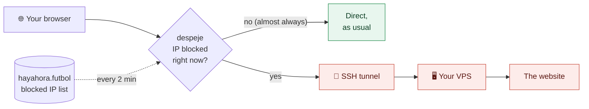

<p align="center">
  
</p>

<h1 align="center">despeje</h1>

<p align="center">
  <b>Don't let football take down your internet.</b><br>
  When LaLiga gets half the internet blocked in Spain during matches, despeje routes
  <b>only the affected websites</b> through your own server. Everything else stays direct.
</p>

<p align="center">
  <a href="https://github.com/Joseluk/despeje/releases/latest"></a>
  <a href="https://github.com/Joseluk/despeje/releases"></a>
  <a href="https://github.com/Joseluk/despeje/actions/workflows/ci.yml"></a>
  
  <a href="LICENSE"></a>
</p>

<p align="center">
  <a href="#install">Install</a> ·
  <a href="#how-it-works">How it works</a> ·
  <a href="#why-not-a-vpn">Why not a VPN?</a> ·
  <a href="#faq">FAQ</a> ·
  <a href="README.md">Español</a>
</p>

---

## The problem

During LaLiga matches, Spanish ISPs block **shared IP addresses** of Cloudflare,
Vercel, GitHub, Fastly and other networks by court order. Each of those IPs
serves thousands of websites that have nothing to do with football: shops,
banks, documentation, work tools, blogs… and they all go dark at once, without
warning, until the match ends.

[hayahora.futbol](https://hayahora.futbol/#sobre-los-bloqueos) monitors this in
real time and publishes which IPs are blocked at any moment. despeje uses that
list so you don't notice.

## What despeje does

- 🎯 **Only what's blocked.** It reads the hayahora.futbol list every 2 minutes
  and diverts *only* those connections. Everything else stays direct, at full speed.
- 🏠 **Through your own server.** Traffic leaves via **your** VPS over an SSH
  tunnel: no third-party VPN, no accounts, nothing to install on the server
  besides the `sshd` it already has.
- ⚡ **One command.** Paste one line into PowerShell, no admin rights. It starts
  with your session and uninstalls just as easily.
- 🧠 **Self-learning.** If a site hangs mid-match and isn't on the list yet, it's
  routed via the VPS and re-tested directly every 2 minutes.
- 🛟 **Fail-safe.** If despeje stops, Windows goes back to direct connections.
- 🔒 **Secure and open.** The VPS user can only open tunnels, the server's
  host key is verified, and binaries are built by GitHub Actions with SHA-256 sums.

## How it works



1. Windows uses despeje as its proxy (a PAC script on `127.0.0.1:9119`).
2. For each connection, despeje resolves the IP and checks it against the
   block list for your ISP.
3. Blocked IPs are opened from your VPS over SSH; everything else goes direct.

## Install

**You need:** Windows 10 or 11 and a Linux VPS outside Spain (or on an
unblocked network) that you can SSH into with a `sudo` user. Any cheap VPS works.

Open **PowerShell** (no admin needed) and paste:

```powershell
irm https://raw.githubusercontent.com/Joseluk/despeje/main/install.ps1 | iex
```

It asks for your VPS `user@ip`, your ISP and the mode, shows what it's going to
change, and then:

1. downloads despeje from [Releases](https://github.com/Joseluk/despeje/releases) and verifies its SHA-256,
2. creates a dedicated SSH key in `%USERPROFILE%\.despeje` (your `~/.ssh` is untouched),
3. logs into your VPS and runs [`setup-vps.sh`](setup-vps.sh), which creates a
   `despeje` user that can only open tunnels,
4. checks everything works and sets it to start at login.

Run the same command again to **update**. Unattended installs and manual VPS
setup are described in the [Spanish README](README.md#instalación).

## Why not a VPN?

|                                   | **despeje** | Commercial VPN | Cloudflare WARP |
|-----------------------------------|:-----------:|:--------------:|:---------------:|
| Diverts only blocked traffic      | ✅ | ❌ all traffic | ❌ all traffic |
| Exits through **your** server     | ✅ | ❌ | ❌ |
| Free (if you already have a VPS)  | ✅ | ❌ | ✅ |
| Speed for everything else         | yours | the VPN's | WARP's |
| Services that block VPNs (streaming, banks) | stay direct | may fail | may fail |
| Open source                       | ✅ | usually not | ❌ |

## Usage

Nothing to do: browse as usual. Live status at <http://127.0.0.1:9119/status>,
log in `%USERPROFILE%\.despeje\despeje.log`, settings in
`%USERPROFILE%\.despeje\config.json`.

| `mode` | What goes through the VPS |
|--------|---------------------------|
| `auto` | only IPs blocked **now** + those that hang directly during a match (recommended) |
| `cdn`  | all Cloudflare ranges, **always** |
| `all`  | everything (except your local network) |

`direct` and `via_vps` force a route and accept IPs, CIDR ranges or domains
(subdomains included), e.g. `"direct": ["tiktok.com"]`.

Something wrong? Run `& $env:USERPROFILE\.despeje\despeje.exe -check` and see
[Si algo falla](README.md#si-algo-falla), or
[open an issue](https://github.com/Joseluk/despeje/issues/new/choose).

## Uninstall

```powershell
irm https://raw.githubusercontent.com/Joseluk/despeje/main/uninstall.ps1 | iex
```

On the VPS: `curl -fsSL https://raw.githubusercontent.com/Joseluk/despeje/main/setup-vps.sh | sudo bash -s -- --remove`

## FAQ

**Will the rest of my browsing get slower?** Practically not. Unblocked traffic
goes direct; it only passes through despeje locally, which handles over 8 Gbps.
With a proxy set, browsers use HTTP/2 instead of HTTP/3, which is rarely noticeable.

**Windows Defender says it's a trojan.** Detections ending in `!ml` are
Defender's machine-learning model judging a new, unsigned program that runs
hidden, starts at login and opens SSH tunnels. Check your binary's SHA-256
against the release's `SHA256SUMS`, allow it, and please report the false
positive to Microsoft. Details in the
[Spanish README](README.md#por-qué-windows-defender-dice-que-es-un-troyano).

**Is this for watching pirated football?** No. It's so your bank, your shop or
your code repository keep working when they get taken down as collateral damage.

**Why SSH and not WireGuard?** Nothing to install or open on the server, and no
admin rights on Windows. The trade-off: TCP only, via proxy, which is what the
web uses.

## Credits

[hayahora.futbol](https://hayahora.futbol) measures the blocks in real time and
publishes the data openly. [OONI](https://ooni.org) documents their impact.

Code signing policy, roles and privacy policy:
[README.md#code-signing-policy](README.md#code-signing-policy).

## License

[MIT](LICENSE)
