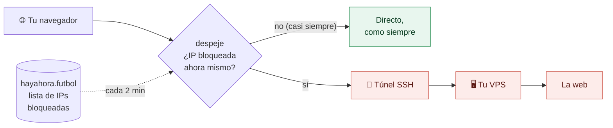

<p align="center">
  
</p>

<h1 align="center">despeje</h1>

<p align="center">
  <b>Que el fútbol no te tumbe internet.</b><br>
  Cuando LaLiga hace bloquear media internet durante los partidos, despeje saca por
  <b>tu propio servidor</b> solo las webs afectadas. Todo lo demás sigue en directo.
</p>

<p align="center">
  <a href="https://github.com/Joseluk/despeje/releases/latest"></a>
  <a href="https://github.com/Joseluk/despeje/releases"></a>
  <a href="https://github.com/Joseluk/despeje/actions/workflows/ci.yml"></a>
  
  <a href="LICENSE"></a>
</p>

<p align="center">
  <a href="#instalación">Instalación</a> ·
  <a href="#cómo-funciona">Cómo funciona</a> ·
  <a href="#y-por-qué-no-una-vpn">¿Y una VPN?</a> ·
  <a href="#si-algo-falla">Si algo falla</a> ·
  <a href="#preguntas">Preguntas</a> ·
  <a href="README.en.md">English</a>
</p>

---

## El problema

Cada partido de LaLiga, los operadores españoles bloquean por orden judicial
**IPs compartidas** de Cloudflare, Vercel, GitHub, Fastly y otras redes. Detrás
de cada una de esas IPs hay miles de webs que no tienen nada que ver con el
fútbol: tiendas, bancos, documentación, herramientas de trabajo, blogs… y todas
caen a la vez, sin aviso, hasta que termina el partido.

[hayahora.futbol](https://hayahora.futbol/#sobre-los-bloqueos) lo vigila en
tiempo real y publica qué IPs están bloqueadas en cada momento. despeje usa
esa lista para que tú no lo notes.

## La solución

<table>
  <tr>
    <td width="33%" valign="top">
      <h3>🎯 Solo lo bloqueado</h3>
      Lee la lista de hayahora.futbol cada 2 minutos y desvía
      <b>únicamente</b> esas conexiones. Netflix, tu banco o tu videollamada
      siguen yendo en directo, a toda velocidad.
    </td>
    <td width="33%" valign="top">
      <h3>🏠 Por tu servidor</h3>
      Sale por <b>tu</b> VPS a través de un túnel SSH. Sin VPN de terceros,
      sin cuentas, sin suscripciones, y sin instalar nada en el servidor: basta
      con el <code>sshd</code> que ya tiene.
    </td>
    <td width="33%" valign="top">
      <h3>⚡ Un comando</h3>
      Se instala pegando una línea en PowerShell, sin permisos de
      administrador. Arranca solo al iniciar sesión y se desinstala igual de
      fácil.
    </td>
  </tr>
  <tr>
    <td width="33%" valign="top">
      <h3>🧠 Aprende solo</h3>
      Si en pleno partido una web se queda colgada y aún no está en la lista,
      la saca por el VPS y la vuelve a probar en directo cada 2 minutos.
    </td>
    <td width="33%" valign="top">
      <h3>🛟 Sin riesgo</h3>
      Si despeje se para, Windows vuelve a salir en directo como siempre. Nunca
      te deja sin internet.
    </td>
    <td width="33%" valign="top">
      <h3>🔒 Seguro y abierto</h3>
      El usuario del VPS solo puede abrir túneles, la identidad del servidor se
      verifica y los binarios se compilan en GitHub Actions con su SHA-256.
    </td>
  </tr>
</table>

## Cómo funciona



1. Windows usa despeje como proxy (un script PAC en `127.0.0.1:9119`).
2. Para cada conexión, despeje resuelve la IP y mira si está en la lista de
   bloqueos de tu operador.
3. Si lo está, la abre desde tu VPS por SSH; si no, sale en directo.

## Instalación

**Necesitas:** Windows 10 u 11 y un VPS Linux fuera de España (o en una red sin
bloqueos) al que entres por SSH con un usuario con `sudo`. Cualquier VPS barato
sirve.

Abre **PowerShell** (no hace falta como administrador) y pega:

```powershell
irm https://raw.githubusercontent.com/Joseluk/despeje/main/install.ps1 | iex
```

Te preguntará el `usuario@ip` de tu VPS, tu operador y el modo, te enseñará lo
que va a cambiar y, si le dices que sí:

1. descarga despeje de las [Releases](https://github.com/Joseluk/despeje/releases) y comprueba su SHA-256,
2. crea una clave SSH propia en `%USERPROFILE%\.despeje` (no toca tu `~/.ssh`),
3. entra en tu VPS y ejecuta [`setup-vps.sh`](setup-vps.sh), que crea un usuario
   `despeje` que solo puede abrir túneles,
4. comprueba que todo funciona y lo deja arrancando al iniciar sesión.

Para **actualizar**, vuelve a ejecutar el mismo comando.

<details>
<summary><b>Instalar sin preguntas</b></summary>

```powershell
$env:DESPEJE_VPS='ubuntu@203.0.113.10'; $env:DESPEJE_ISP='movistar'; $env:DESPEJE_MODE='auto'; $env:DESPEJE_YES='1'
irm https://raw.githubusercontent.com/Joseluk/despeje/main/install.ps1 | iex
```

Otras variables: `DESPEJE_SKIP_VPS=1` (si ya preparaste el VPS a mano),
`DESPEJE_VERSION=v0.1.3` (fijar versión).
</details>

<details>
<summary><b>Preparar el VPS a mano</b> (sin dar <code>sudo</code> al instalador)</summary>

Ejecuta en el VPS, con la clave pública que te muestra el instalador
(`%USERPROFILE%\.despeje\id_ed25519.pub`):

```bash
curl -fsSL https://raw.githubusercontent.com/Joseluk/despeje/main/setup-vps.sh | sudo bash -s -- 'ssh-ed25519 AAAA... despeje@tupc'
```

y luego instala en Windows con `$env:DESPEJE_SKIP_VPS='1'`. El script es
idempotente; si tu `sshd` tiene `AllowUsers`, añade el usuario con un fichero en
`/etc/ssh/sshd_config.d/` y valida la configuración con `sshd -t` antes de
recargar (si no valida, deshace el cambio).
</details>

## ¿Y por qué no una VPN?

|                                   | **despeje** | VPN comercial | Cloudflare WARP |
|-----------------------------------|:-----------:|:-------------:|:---------------:|
| Solo desvía lo bloqueado          | ✅ | ❌ todo tu tráfico | ❌ todo tu tráfico |
| Sale por un servidor **tuyo**     | ✅ | ❌ | ❌ |
| Gratis (si ya tienes un VPS)      | ✅ | ❌ | ✅ |
| Velocidad del resto de webs       | la tuya | la de la VPN | la de WARP |
| Servicios que vetan VPNs (streaming, bancos) | siguen en directo | pueden fallar | pueden fallar |
| Código abierto                    | ✅ | normalmente no | ❌ |

Si no tienes VPS y solo quieres salir del paso, una VPN o WARP funcionan.
despeje es para quien prefiere no mandar todo su tráfico por un tercero.

## Uso

No hay que hacer nada: navega como siempre. Para ver qué está pasando:

- **Estado en vivo**: <http://127.0.0.1:9119/status>, con las IPs bloqueadas
  ahora, conexiones directas / por el VPS y las últimas que han ido por el túnel.
- **Log**: `%USERPROFILE%\.despeje\despeje.log`
- **Configuración**: `%USERPROFILE%\.despeje\config.json` (tras editarla, vuelve a
  ejecutar el instalador o reinicia la tarea `despeje`).

### Modos

| `mode` | Qué va por el VPS |
|--------|-------------------|
| `auto` | solo las IPs bloqueadas **ahora** + las que se cuelguen en directo durante un partido (recomendado) |
| `cdn`  | todos los rangos de Cloudflare **siempre**, haya fútbol o no |
| `all`  | todo el tráfico (salvo tu red local) |

`isp` elige la lista de tu operador: `any`, `movistar`, `vodafone`, `orange`,
`digi`, `masmovil`. `via_vps` y `direct` fuerzan una ruta y aceptan IPs, rangos
CIDR o dominios (un dominio incluye sus subdominios):

```json
"direct": ["tiktok.com", "netflix.com"],
"via_vps": ["ejemplo-siempre-bloqueado.com", "203.0.113.0/24"]
```

`fallback: false` desactiva el reintento automático por el VPS: solo irán por
ahí las IPs de la lista.

## Si algo falla

Abre un **PowerShell normal** (no como administrador) y lanza la comprobación,
que prueba cada pieza por separado:

```powershell
& $env:USERPROFILE\.despeje\despeje.exe -check
```

| Mensaje | Qué pasa y cómo se arregla |
|---------|----------------------------|
| `Acceso denegado` al crear la clave | Una carpeta de tu perfil tiene permisos rotos. Restáuralos con el `icacls ... /reset /T` que te indica el error y repite la instalación. |
| `... no está en known_hosts` | El instalador no pudo guardar la huella del VPS. Vuelve a ejecutarlo. |
| `El VPS no deja abrir túneles a este usuario` | `sshd` tiene `AllowTcpForwarding no`, `DisableForwarding yes` o un `PermitOpen` restrictivo para `despeje`. Revisa `sshd -T -C user=despeje,host=x,addr=1.2.3.4`. |
| `El VPS acepta el túnel pero no logra salir a internet` | El VPS no llega a la web: comprueba con `curl -4 https://www.cloudflare.com` desde el VPS, y que no esté también en España. |
| `Tu conexión bloquea ...? no, responde en directo` | No es un error: ahora mismo esa IP no está bloqueada para ti. |
| Windows Defender lo detecta como troyano (`Trojan:Win32/Bearfoos.A!ml` o parecido) | Falso positivo: mira [la pregunta sobre el antivirus](#por-qué-windows-defender-dice-que-es-un-troyano). |
| Una web te da «Access Denied» o te pide verificar que no eres un robot | Seguramente esa conexión salió por el VPS y el servicio desconfía de IPs de centros de datos (pasa con Akamai: TikTok, algunos bancos…). Míralo en `ultimas_por_vps` / `ips_aprendidas` de <http://127.0.0.1:9119/status> y añade el dominio a `direct`. |

Si el instalador se cortó en la comprobación, vuelve a ejecutarlo: con «Solo
actualizar» no toca el VPS y termina de dejarlo en marcha.

¿Nada de esto? [Abre un issue](https://github.com/Joseluk/despeje/issues/new/choose)
con la salida de `-check`.

## Desinstalar

```powershell
irm https://raw.githubusercontent.com/Joseluk/despeje/main/uninstall.ps1 | iex
```

Y en el VPS, si quieres quitar el usuario:

```bash
curl -fsSL https://raw.githubusercontent.com/Joseluk/despeje/main/setup-vps.sh | sudo bash -s -- --remove
```

## Preguntas

<details>
<summary><b>¿Pierdo velocidad en el resto de webs?</b></summary>

Prácticamente nada. Lo que no está bloqueado sale en directo; solo atraviesa
despeje en local, que mueve más de 8 Gbps en un PC normal, así que no es el
cuello de botella. Lo único que cambia es que, con un proxy configurado, los
navegadores no usan HTTP/3 (QUIC) y van por HTTP/2, algo que normalmente no se
nota.
</details>

<details>
<summary><b>¿Y lo que va por el VPS?</b></summary>

Va a la velocidad y latencia de tu VPS. Por eso `auto` es el modo recomendado:
solo pasa por ahí lo que ahora mismo no funcionaría de ninguna otra forma.
</details>

<details>
<summary><b>¿Puede ir por el VPS algo que no está bloqueado?</b></summary>

Solo en dos casos: si lo pides en `via_vps`, o si durante un partido una
conexión directa se queda colgada. En ese caso despeje lo trata como un bloqueo
nuevo que aún no está en la lista y lo saca por el VPS, pero vuelve a probar esa
IP en directo cada 2 minutos y la suelta en cuanto responde. Un error normal del
sitio (conexión rechazada) no cuenta, y fuera de los partidos esto no se activa.
</details>

<details>
<summary><b>¿Qué apps cubre?</b></summary>

Las que usan el proxy de Windows: Edge, Chrome, Firefox (por defecto) y la
mayoría de programas. Juegos o apps que lo ignoran salen en directo.
</details>

<details>
<summary><b>¿Por qué SSH y no WireGuard?</b></summary>

Porque no hay que instalar ni abrir nada en el servidor y no hacen falta
permisos de administrador en Windows. A cambio solo cubre TCP vía proxy, que es
lo que usa la web.
</details>

<details>
<summary><b>¿Esto es para ver el fútbol pirata?</b></summary>

No. Es para que tu banco, tu tienda o tu repositorio sigan funcionando cuando
los apagan de rebote. Los datos de bloqueos son de
[hayahora.futbol](https://hayahora.futbol), que los ofrece precisamente para
usos así.
</details>

### ¿Por qué Windows Defender dice que es un troyano?

Las detecciones terminadas en `!ml` (como `Trojan:Win32/Bearfoos.A!ml`) no
son firmas de malware conocido: son el modelo de *machine learning* de Defender
juzgando el comportamiento de un programa nuevo y sin firmar. despeje hace
cosas que, vistas sin contexto, se parecen a un troyano de acceso remoto: corre
sin ventana, arranca con la sesión, usa el proxy de Windows y abre túneles SSH.

Lo hemos reducido todo lo posible: los binarios llevan descripción, versión e
icono, y el proceso en segundo plano ya no toca el proxy de Windows (lo
configura el instalador una vez). Pero hasta que un binario nuevo gana
reputación, puede volver a pasar. Si te ocurre:

1. **Comprueba que tu binario es el oficial**: su SHA-256 debe coincidir con
   `SHA256SUMS` de la [release](https://github.com/Joseluk/despeje/releases)
   (`Get-FileHash $env:USERPROFILE\.despeje\despejew.exe`). Son compilados por
   GitHub Actions a partir de este código.
2. **Permítelo**: Seguridad de Windows → Protección antivirus → Historial de
   protección → la amenaza → Acciones → *Permitir en el dispositivo*. Después,
   vuelve a ejecutar el instalador.
3. **Avisa a Microsoft** del falso positivo en
   <https://www.microsoft.com/wdsi/filesubmission> («Incorrectly detected as
   malware»), y [abre un *issue*](https://github.com/Joseluk/despeje/issues/new/choose)
   para que lo sepamos.

## Contribuir

Los *issues* y *pull requests* son bienvenidos: bugs, soporte para más
operadores, macOS/Linux, traducciones… Mira [CONTRIBUTING.md](CONTRIBUTING.md).
Si despeje te ha salvado un domingo, dale una ⭐: ayuda a que lo encuentre
más gente.

## Agradecimientos

- [hayahora.futbol](https://hayahora.futbol), que mide los bloqueos en tiempo
  real y publica los datos en abierto. Sin ellos, despeje no existiría.
- [OONI](https://ooni.org), por documentar el impacto de estos bloqueos.

## Desarrollo

```powershell
go test ./...                       # incluye un servidor SSH en memoria que hace de VPS
.\build.ps1                         # dist\despeje.exe (consola) y dist\despejew.exe (sin ventana)
$env:DESPEJE_LOCAL_DIST="$PWD\dist"; .\install.ps1   # instalar tu build local
```

Las releases se publican solas con GitHub Actions al subir una etiqueta `v*`.

## Code signing policy

*Política de firma de código.* Los binarios de Windows se firman con
Authenticode en GitHub Actions a partir de este repositorio, sin pasos
manuales en ningún equipo. **Estado:** solicitado a SignPath Foundation; hasta
que lo aprueben, las releases se publican sin firmar.

Free code signing provided by [SignPath.io](https://about.signpath.io/),
certificate by [SignPath Foundation](https://signpath.org/).

| Rol | Personas |
|-----|----------|
| Autores y revisores (*committers and reviewers*) | [Joseluk](https://github.com/Joseluk) |
| Aprobadores (*approvers*) | [Joseluk](https://github.com/Joseluk) |

Cada release firmada la aprueba a mano un aprobador en SignPath. El instalador
verifica la firma y no instala un binario con la firma rota.

**Privacy policy.** This program will not transfer any information to other
networked systems unless specifically requested by the user or the person
installing or operating it. En concreto: abre túneles SSH a **tu** VPS (el que
indicas al instalar) solo para las conexiones que deben salir por él, y
descarga la lista pública de IPs bloqueadas de
[hayahora.futbol](https://hayahora.futbol), un servicio de terceros que recibe
esa petición como cualquier visita (tu IP y la versión de despeje). No tiene
telemetría ni contacta con ningún servidor del proyecto.

<details>
<summary>Activar la firma (mantenedores)</summary>

1. Proyecto aprobado en [SignPath Foundation](https://signpath.org/apply), con
   el repositorio conectado como *trusted build system* (GitHub.com).
2. En SignPath: proyecto `despeje`, política de firma `release-signing` y como
   configuración de artefacto el contenido de
   [`.signpath/artifact-configuration.xml`](.signpath/artifact-configuration.xml).
3. En GitHub → Settings → Secrets and variables → Actions:
   - secreto `SIGNPATH_API_TOKEN` (token de API de un usuario CI de SignPath con
     permiso de *submitter* en el proyecto),
   - variable `SIGNPATH_ORGANIZATION_ID`,
   - opcionales si los slugs son otros: `SIGNPATH_PROJECT_SLUG`,
     `SIGNPATH_POLICY_SLUG`, `SIGNPATH_ARTIFACT_CONFIGURATION_SLUG`.
4. Prueba sin publicar nada: Actions → release → *Run workflow*. Al aprobar la
   petición en SignPath, el run deja los `.exe` firmados como artefacto.

Sin la variable `SIGNPATH_ORGANIZATION_ID` el workflow publica sin firmar,
como hasta ahora.
</details>

## Licencia

[MIT](LICENSE). Hecho en España, con cariño y cierta frustración, por
[Joseluk](https://github.com/Joseluk).
